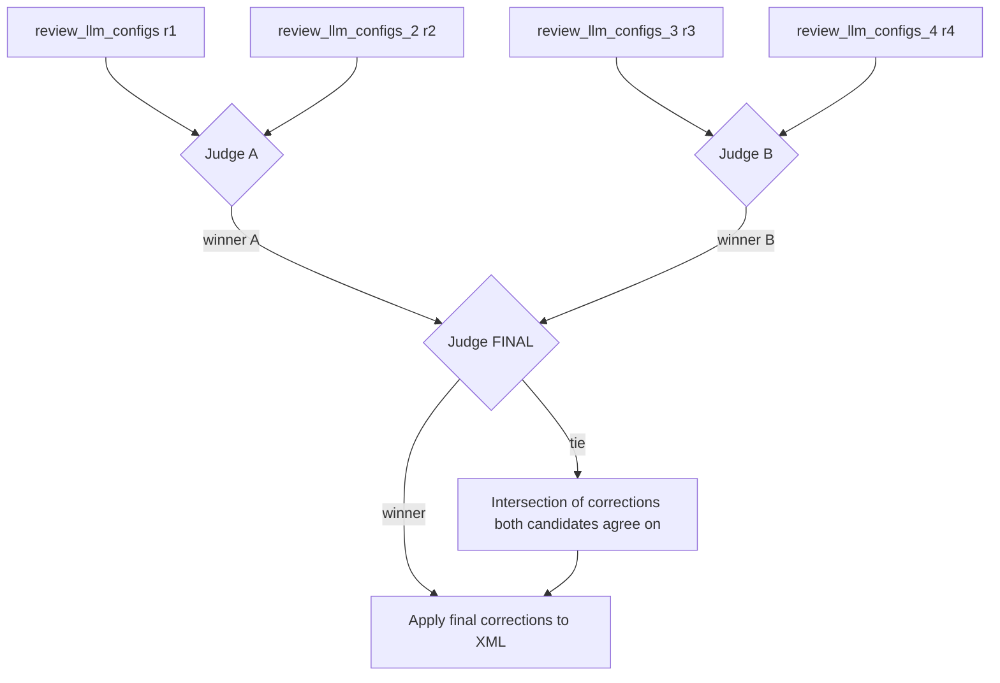

# CC-Mappers
Mappers for [Crusader Conflicts](https://github.com/szmania/Crusader-Wars/releases/latest), Community Successor for Crusader Wars mod.

## Mapper Loading Order

The Crusader Conflicts mod loads culture, faction, and terrain mapping XML files in a specific order to allow for overrides. The loading process is as follows:

1.  **Base Mappers**: The official playthrough base mappers are loaded first. These files are identified by the naming convention `OfficialCC_*.xml`.
2.  **Optional Add-on Mappers**: After the base mappers, optional add-on files that are not submod files are loaded in alphabetical order.
3.  **Submod Mappers**: After the optional add-ons, submod mappers are loaded. These are identified by a `submod_tag` attribute in the root element of the XML file.
4.  **Submod Optional Add-on Mappers**: Finally, optional add-ons for submods are loaded in alphabetical order. These files are identified by a `submod_addon_tag` attribute in the root element, which links them to a specific submod.

This loading order means that files loaded later will overwrite mappings from files loaded earlier. For example, a submod mapper can override a base mapper, and a submod's optional add-on can override the submod's own mappings. When multiple files of the same type are loaded (like optional add-ons), the one that comes last alphabetically takes precedence.
The files within the `Cultures`, `Factions`, `Terrains`, and `Titles` directories are loaded in the same way, and optional add ons and submod optional addons are loaded alphabetically within their respective loading group. If you have multiple files in these directories, their contents will be merged.

## Custom Mappers

### Custom Example

This directory serves as an example of how to structure a custom mapper for Crusader Conflicts.

### File Structure and Purpose

- `Cultures/`: This directory contains XML files that define what Crusader Kings 3 heritages and cultures are mapped to what factions in Total War: Attila.
    - `OfficialCC_Custom_Default_Cultures.xml`: An example culture definition file.
- `Factions/`: This directory contains XML files that define the factions and their units.
    - `OfficialCC_Custom_Default_Factions.xml`: An example faction definition file.
- `Terrains/`: This directory contains XML files that define the terrains for your custom map, including coastal regions, straits, river crossings, and settlement coordinates.
- `Titles/` (Optional): This directory can contain XML files to assign specific men-at-arms units to landed titles (e.g., counties, duchies, kingdoms). This is an optional feature.
    - `Counties.xml`: Example for county-level titles.
    - `Duchies.xml`: Example for duchy-level titles.
    - `Kingdoms.xml`: Example for kingdom-level titles.
- `Mods.xml`: This file lists the mods that this custom mapper depends on, including optional submods. Note the order in which the Submod appears is the load order the submod will load. Pack files at the top of the file will load last.
- `TimePeriod.xml`: This file defines the time period for your custom map.
- `tag.txt`: The value in this file is the name that shows in the dropdown within the Crusader Conflicts Custom mapper tab. This is the tag for your custom mapper, and this value MUST start with "Custom" in order to appear in the Custom mapper screen. You can have multiple folders with the same tag.txt value, if you want, for example, to have different units for different TimePeriod.xml values. eg. Early, High, Late, Renaissance periods.
- `background.png`: A background image for the custom map in the launcher and Total War: Attila.

### Required Files

For a custom mapper to be valid, the following files are required:

- `Mods.xml`
- `TimePeriod.xml`
- `tag.txt`
- At least one XML file in the `Cultures/` directory.
- At least one XML file in the `Factions/` directory.
- At least one XML file in the `Terrains/` directory.

Submods, submod addons, and other general addons are not required.

## LLM Configuration

The mapper tools support LLM-assisted unit assignment and roster review. All LLM behavior is configured in a JSON file passed via `--llm-config` (see `mapper_tools/llm_config.json` for a complete example).

### Reviewer Tiers

Roster and culture review passes can use multiple independent reviewer models:

- `review_llm_configs` — the primary reviewer tier (required for review passes).
- `review_llm_configs_2`, `review_llm_configs_3`, `review_llm_configs_4` — optional additional reviewer tiers. Each tier is independent: you can run 2-way or 3-way consensus without configuring tier 4.

Each reviewer tier uses the same `LLMConfig` object schema (`name`, `model`, `api_base`, `api_key`, `request_timeout`, `max_retries`, `priority`, ...). Reviewer results are cached per tier using `|r1`..`|r4` cache-key suffixes, so each reviewer keeps its own cache entry.

### Review Selection Mode

`global_settings.review_selection_mode` chooses how multiple reviewer answers are combined:

- `"consensus"` (default) — legacy iterative agreement. Reviewers re-queue disputed items up to `max_consensus_review_rounds` times until they agree (unanimous intersection, or 2-of-3 with `consensus_strategy: "majority"`).
- `"tournament"` — single-elimination judge bracket (fixed 2 rounds, no re-queue loops).

When the field is absent, the mode is auto-detected: **tournament activates only when reviewer tiers 2, 3, AND 4 are all configured**; otherwise consensus is used. A lone `review_llm_configs_4` without tiers 2/3 logs a warning and falls back to consensus. An explicit `review_selection_mode` value always wins over auto-detection.

### Judge Tiers

`judge_llm_configs` — optional dedicated LLM tiers used ONLY by the tournament judge calls (Judge A, Judge B, and the final). Reviewer calls never touch it. Fallback chain when absent: `review_llm_configs` → `llm_configs`.

Recommendation: point the judge at a small/fast/cheap model with `tool_calling` unset or false — judges emit tiny strict JSON (`{"winner": "A"|"B"|"tie", "reason": "..."}`).

### Tournament Bracket

- **Round 1 (semifinals):** Judge A picks between the r1 vs r2 candidates; Judge B picks between r3 vs r4 (both run in parallel).
- **Round 2 (FINAL):** the final judge picks between the two Round-1 winners; the winner's corrections are applied to the XML.
- A tie (or an invalid judge response) applies the unanimous intersection of both candidates — never worse than the legacy consensus. If both candidates are empty, nothing is applied and no judge call is made.

### When to Use Which Mode

| Mode | Behavior | Cost profile |
|---|---|---|
| `consensus` | Iterative agreement; disputed items are re-queued up to `max_consensus_review_rounds` times | Cheaper per round, but re-queue loops can multiply calls |
| `tournament` | Fixed 2 rounds, decisive | 4 reviewer calls + 3 small judge calls per review request on a cold cache; 0 network calls on a warm cache |

### Cache Invalidation

The review config fingerprint includes all reviewer tiers (r1–r4), the judge tiers, the selection mode, and the prompt version. Changing any of these fields (or the models/temperatures inside them) invalidates cached review results, causing a **one-time re-query** of affected entries on the next run.

## License
The original source code and all further edits of this repository fall under the GNU GENERAL PUBLIC LICENSE Version 3 license of distribution, and it was copied from the v1.2.2 version of the CW-Mappers distributed here inside the Crusader-Wars release (which is GPL3 licensed) https://github.com/farayC/Crusader-Wars/releases/tag/v1.0.14 and can be found in the `crusader-wars.zip` file within that Crusader-Wars v1.0.14 release.
